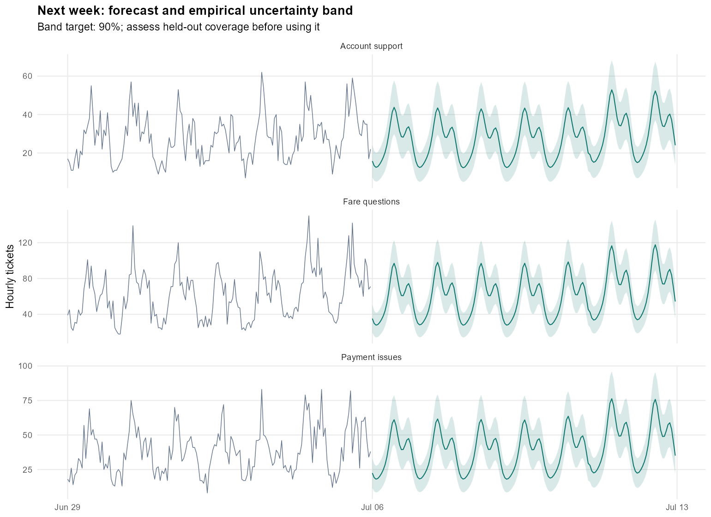

# Support Demand Forecasting & Staffing Planner

**Where will support capacity fall short next week, and what could the operations team change?**

This R and Shiny project joins demand forecasts with handling-time and staffing assumptions. It gives an operations lead a repeatable way to examine pressure points, compare capacity scenarios and explain a staffing request.

All data are synthetic. This is an independent portfolio project, not Uber data, an Uber deployment or evidence of business savings.



## Open the project

1. Clone the repository: `git clone https://github.com/Lifewitdata/r-support-demand-staffing.git`
2. Open `support-staffing.Rproj` in RStudio, or set the working directory to the cloned folder.
3. Run the following in the R console:

```r
source('scripts/setup.R')
shiny::runApp('.')
```

The package includes prepared data, so you can open the dashboard without rebuilding the analysis. Setup installs three top-level packages: **data.table, ggplot2 and shiny**, plus their dependencies. Use R 4.3 or newer. Internet is needed for package installation, not for the analysis itself.

To rebuild every dataset, forecast, chart and report:

```r
source('scripts/run_pipeline.R')
source('tests/run_tests.R')
```

Or from a terminal in the project folder:

```bash
Rscript scripts/setup.R
Rscript scripts/run_pipeline.R
Rscript tests/run_tests.R
```

The analysis and app are entirely R. No Python, SQL, API key, database account or paid service is required.

## Read the result first

- Open `outputs/weekly_report.html` in a browser after cloning. Keep its adjacent `figures` folder in place.
- Read `outputs/weekly_brief.md` for the recommendation, assumptions and next actions.
- Open `outputs/holdout_scores.csv` and `outputs/interval_coverage.csv` to assess the forecast.
- Open `outputs/verification.md` for the checks performed on the delivered build.

## Five dashboard views

| View | Question it answers |
|---|---|
| Operations overview | How much demand and handling work arrived, and how did it compare with capacity? |
| Forecast validation | Did the selected model beat a simple weekly benchmark on later weeks? |
| Staffing scenarios | What changes if demand, handling time, occupancy, shrinkage or paid staffing changes? |
| Workload deep dive | How much of the recent workload change comes from volume versus handling time? |
| Data & handoff | What checks passed, and what should the operations lead do next? |

The historical date filter affects the overview. Forecasts and workload deep dives use fixed, documented periods. Queue selection applies across the app. A scenario can be downloaded with its assumptions recorded in the CSV.

## Forecast design

Hourly demand is evaluated separately for three fictional queues. The candidates are:

- **Weekly seasonal naive:** repeat the last observed week.
- **Seasonal count regression:** R's `stats::glm`, using a quasi-Poisson log link, weekday effects, daily Fourier terms and a linear trend.

Three rolling validation weeks select a model for each queue. Two later weeks calibrate empirical bands. Three final weeks evaluate the frozen choices. At every forecast origin, only earlier observations enter model fitting. The final next-week forecast refits on all available history.

The uncertainty bands are empirically calibrated to a 90% target. Serial dependence and distribution changes mean this is not a formal coverage guarantee. Held-out coverage is shown. Do not assume the statistical model wins; read the benchmark comparison.

## Staffing calculation

```text
required paid agents each hour = ceiling(
  [forecast tickets × recent average handling minutes + opening-backlog allocation]
  / [60 × (1 − shrinkage) × productive occupancy]
)
```

Opening backlog is a fluid estimate of unserved handling workload, not a measured queue of individual customers. It is spread over a user-selected clearance period for the staffing requirement. Separately, the app rolls forward that opening workload against the proposed schedule to estimate ending backlog.

Hourly gaps sum to **paid agent-hours**, not full-time hires. The planner does not optimise shifts, enforce labour rules or guarantee an SLA. The upper forecast band is a stress scenario, not a simultaneous coverage promise across the whole week.

## Project layout

- `app.R`: root Shiny entrypoint, ready for RStudio or a Shiny hosting service.
- `R/`: generation, validation, preparation, forecasting, staffing, reporting and server logic.
- `config/settings.R`: explicit simulation and analysis assumptions.
- `scripts/setup.R`: dependency installation.
- `scripts/run_pipeline.R`: full rebuild and weekly report generation.
- `scripts/explore_data.R`: readable EDA for RStudio.
- `tests/run_tests.R`: analytical and Shiny server checks.
- `data/raw/`: generated ticket and schedule sources plus a small CSV sample.
- `data/processed/`: reusable hourly data and the complete app snapshot.
- `outputs/`: CSV results, report, charts, session details and test results.
- `docs/`: methods, metric definitions, role mapping, operational handoff and limitations.
- `www/style.css`: dashboard presentation.

## Deployment

`app.R` sits at the repository root. A deployment needs `R/`, `config/`, `www/`, `data/processed/app_bundle.rds` and `outputs/weekly_brief.md`. Prepared app data are committed deliberately so the dashboard opens without a rebuild. The raw ticket file is not needed at runtime; it is kept for reproducibility.

The app expects its working directory to be the repository root, as RStudio Run App and standard Shiny deployment do. Install dependencies before launching. No hosted version of the app is currently published.

## Weekly refresh

Running `Rscript scripts/run_pipeline.R` rebuilds the complete synthetic demonstration and writes a fresh report. A scheduler can run this command, but no recurring task is installed by the project. For real data, replace the generator with validated imports and preserve the documented table grains and time rules. Do not treat regeneration of synthetic data as a live production feed.

## Why it fits an operations analytics role

It demonstrates repeatable reporting, statistical modelling, operational deep dives, decision tools and clear handoff documentation. It does not claim stakeholder management, mentoring, measured process impact or production deployment that did not happen. See `docs/JD_alignment.md` for the precise mapping.
